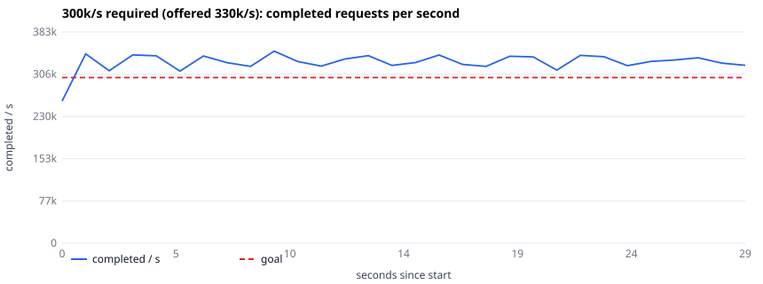
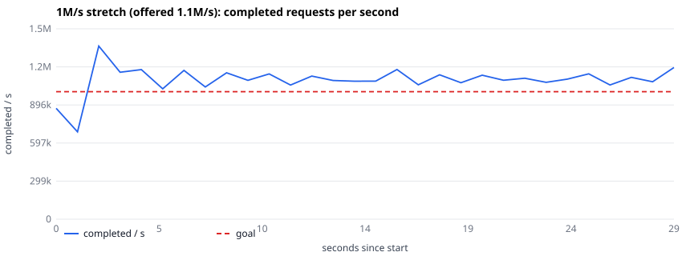
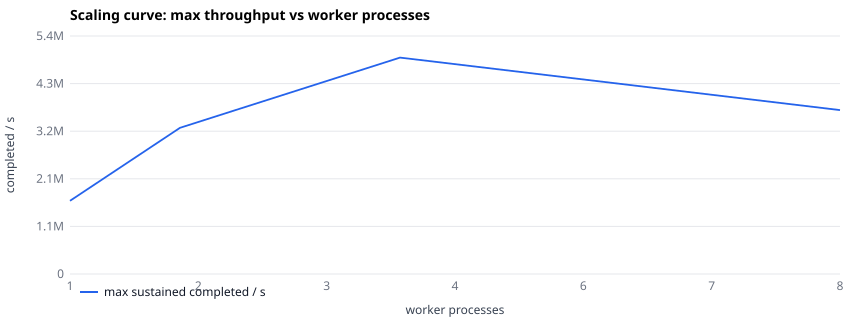

# Throughput benchmark (in-process transport)

Generated: 2026-11-11 23:58:27

## Measured

| Run | Workers | Target req/s | Sustained median req/s | Min 1 s req/s | Completed | p50 / p95 / p99 ms | Exactly-once | Accounted | Lease respected |
|---|---|---|---|---|---|---|---|---|---|
| 300k/s required (offered 330k/s) | 8 | 330,000 | **329,115** | 311,614 | 9,892,260 | 196 / 269 / 335 | True | True | True |
| 1M/s stretch (offered 1.1M/s) | 8 | 1,100,000 | **1,101,677** | 1,022,636 | 32,974,393 | 254 / 485 / 721 | True | True | True |
| max@1 | 1 | max | **1,652,986** | 1,203,293 | 18,300,000 | 172 / 237 / 344 | True | True | True |
| max@2 | 2 | max | **3,300,831** | 2,838,731 | 33,450,000 | 171 / 232 / 331 | True | True | True |
| max@4 | 4 | max | **4,886,070** | 3,678,687 | 53,150,000 | 178 / 248 / 357 | True | True | True |
| max@8 | 8 | max | **3,700,464** | 620,164 | 32,850,000 | 199 / 688 / 913 | True | True | True |





### Scaling curve



| Workers | Max sustained req/s | Per worker | Efficiency vs 1 worker |
|---|---|---|---|
| 1 | 1,652,986 | 1,652,986 | 100% |
| 2 | 3,300,831 | 1,650,416 | 100% |
| 4 | 4,886,070 | 1,221,518 | 74% |
| 8 | 3,700,464 | 462,558 | 28% |

## Simulation assumptions

- Transport is **in-process**: the provider simulator's outcome/latency model runs inside each worker on NumPy frames. No HTTP/JSON per request; these numbers are NOT end-to-end HTTP numbers (see Scenario 1 for the HTTP path).
- Limits raised as permitted by the brief: RPM = 1.25 x offered load, split into equal per-worker leases; ledger rules (601 x 100 ms rolling window, pacing, 1% guard, reconcile) are enforced per lease.
- Simulated latency 150 ms +/- 50 ms, 1% tail up to +1 s, 1% permanent failures; completion is timed by a 10 ms timing wheel, so latency includes up to one tick of scheduling delay.
- Every request id is checked to be finalised exactly once (or still accounted as waiting/in flight).

## Environment

```
{
  "os": "Windows-11-10.0.26200-SP0",
  "python": "3.14.6",
  "numpy": "2.5.4",
  "logical_cpus": 8,
  "machine": "AMD64",
  "processor": "Intel64 Family 6 Model 140 Stepping 1, GenuineIntel"
}
```
