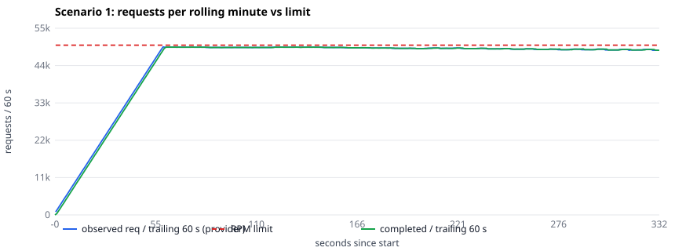

# Scenario 1: reach the available provider capacity

Generated: 2026-11-12 00:22:18  
Overall: **PASS**

## Pass criteria (measured)

| Criterion | Result | Detail |
|---|---|---|
| Completion >= 90% of allowed capacity after warm-up | PASS | 49,023 completed/min after 30s warm-up = 98.0% of 50,000 (lowest full 60 s window: 48,522) |
| No observed 60 s window exceeds the RPM limit (auditor) | PASS | peak 49,539 req / 60 s vs limit 50,000 (99.08%); 27,213 windows at 10 ms resolution |
| No observed 60 s window exceeds the TPM limit (auditor) | PASS | peak 45,810,515 tokens / 60 s vs limit 100,000,000 (45.81%) |
| Every submitted request is accounted for | PASS | load generator acked 329,992 (transport errors 0, safe connect retries 0); server submitted 329,992 = completed 271,397 + waiting 47,580 + expired 501 + rejected 10,514 |
| Run was not stalled by the environment (sleep / suspend) | PASS | load phase took 330s for a 330s schedule |

## Configuration

- Model `model-a`: 50,000 RPM, 100,000,000 TPM
- Offered load: 1000 req/s (= 60,000/min, 120% of capacity), 1,000 estimated tokens each
- Duration: 330 s, warm-up excluded: 30 s

## Measured results

| Metric | Value |
|---|---|
| Submitted (acked) | 329,992 |
| Completed | 271,397 |
| Succeeded | 271,397 |
| Failed | 0 |
| Waiting at end (incl. in flight) | 47,580 |
| Expired | 501 |
| Rejected at admission | 10,514 |
| Completion rate after warm-up | 49,023/min |
| Latency p50 / p95 / p99 (from intended send) | 29434.18 / 57235.18 / 59741.83 ms |
| Provider 429s | 0 |
| Peak rolling-60 s requests (provider) | 49,539 |
| Peak rolling-60 s tokens (provider) | 45,810,515 |

## Observed throughput vs limit



## Why latency is high

The offered load is 120% of capacity, so the excess queues until the 60 s deadline and is then rejected at admission. p50/p95 therefore reflect queueing by design; provider latency itself is ~150 ms.

## Simulation assumptions

- Transport: **HTTP over loopback** (load generator -> control plane -> provider simulator), one machine.
- Simulated provider latency: 150 ms base, +/-50 ms uniform jitter, 1% tail up to +1 s (configurable).
- Actual tokens = estimate x U(0.8, 1.05) on success; the provider meters actual tokens.
- Latency is measured from each request's *intended* send time (open-loop), so it includes queueing.
- The dispatcher keeps a 1% guard below each limit; requests have a 60 s deadline by default.

## Environment

```
{
  "os": "Windows-11-10.0.26200-SP0",
  "python": "3.14.6",
  "cpu_count": 8,
  "machine": "AMD64",
  "processor": "Intel64 Family 6 Model 140 Stepping 1, GenuineIntel"
}
```
