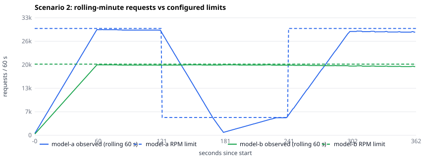
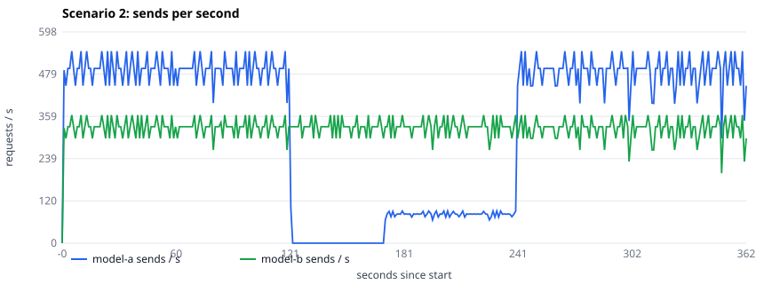

# Scenario 2: different models and changing limits

Generated: 2026-11-12 00:15:04  
Overall: **PASS**

## Pass criteria (measured)

| Criterion | Result | Detail |
|---|---|---|
| model-a stays within its current limits (auditor) | PASS | peak 29,733 req/60 s vs max limit in window 30,000 (99.11%); TPM peak 45.86%; violating windows 0/0 |
| model-b stays within its current limits (auditor) | PASS | peak 19,812 req/60 s vs max limit in window 20,000 (99.06%); TPM peak 45.81%; violating windows 0/0 |
| Model A adapts to the reduction without restart | PASS | A send rate while constrained (after window drained): 4,932/min (limit 5,000); A trailing-60 s window just before restore: 4,933; before: 29,535/min |
| Model A adapts to the restore without restart | PASS | A send rate after restore: 29,161/min (limit 30,000) |
| Model B continues processing while A is constrained | PASS | B send rate before: 19,698/min, during A's constraint: 19,750/min (100.3%) |
| Report shows configured limits and observed throughput over time | PASS | see rpm.svg and the timeline table in reports/s2/report.md |

## Configuration

- model-a: 30,000 RPM / 60M TPM; model-b: 20,000 RPM / 40M TPM
- Offered: 600 req/s to A and 400 req/s to B (each 120% of its limit), 1,000 tokens
- Limit events: t=120s model-a -> 5,000 RPM; t=240s model-a -> 30,000 RPM

## Measured results

| Model | Submitted | Completed | Waiting | Expired | Rejected | p50 / p95 / p99 |
|---|---|---|---|---|---|---|
| model-a | 215,926 | 124,044 | 17,771 | 12,207 | 61,904 | 16479.71 / 55465.16 / 60111.72 ms |
| model-b | 144,072 | 118,314 | 19,272 | 514 | 5,972 | 31613.17 / 60088.65 / 60171.82 ms |

## Limits and observed throughput over time





| t (s) | A limit | A sent/s | A window (60 s) | B limit | B sent/s | B window (60 s) |
|---|---|---|---|---|---|---|
| 0 | 30,000 | 490 | 490 | 20,000 | 326 | 326 |
| 15 | 30,000 | 446 | 7,866 | 20,000 | 297 | 5,243 |
| 30 | 30,000 | 495 | 15,340 | 20,000 | 330 | 10,226 |
| 45 | 30,000 | 446 | 22,716 | 20,000 | 297 | 15,143 |
| 60 | 30,000 | 445 | 29,650 | 20,000 | 297 | 19,767 |
| 75 | 30,000 | 495 | 29,650 | 20,000 | 330 | 19,767 |
| 90 | 30,000 | 446 | 29,551 | 20,000 | 297 | 19,713 |
| 105 | 30,000 | 495 | 29,551 | 20,000 | 330 | 19,713 |
| 120 | 5,000 | 99 | 29,156 | 20,000 | 330 | 19,713 |
| 135 | 5,000 | 0 | 21,731 | 20,000 | 297 | 19,713 |
| 150 | 5,000 | 0 | 14,405 | 20,000 | 330 | 19,800 |
| 165 | 5,000 | 0 | 6,980 | 20,000 | 330 | 19,734 |
| 180 | 5,000 | 82 | 899 | 20,000 | 330 | 19,800 |
| 195 | 5,000 | 66 | 2,121 | 20,000 | 264 | 19,734 |
| 210 | 5,000 | 82 | 3,358 | 20,000 | 330 | 19,734 |
| 225 | 5,000 | 66 | 4,587 | 20,000 | 264 | 19,734 |
| 240 | 30,000 | 446 | 5,297 | 20,000 | 297 | 19,701 |
| 255 | 30,000 | 495 | 11,393 | 20,000 | 330 | 19,668 |
| 270 | 30,000 | 544 | 17,531 | 20,000 | 363 | 19,635 |
| 285 | 30,000 | 495 | 23,587 | 20,000 | 330 | 19,602 |
| 300 | 30,000 | 446 | 29,156 | 20,000 | 297 | 19,437 |
| 315 | 30,000 | 544 | 29,156 | 20,000 | 363 | 19,437 |
| 330 | 30,000 | 495 | 29,057 | 20,000 | 330 | 19,371 |
| 345 | 30,000 | 495 | 29,008 | 20,000 | 330 | 19,338 |
| 360 | 30,000 | 347 | 29,008 | 20,000 | 231 | 19,338 |

## How the drop is handled

Sends already made in the trailing 60 s still count against the new 5,000 RPM limit, so model A sends nothing until its window drains below 5,000, then paces at ~83/s. Waiting requests are re-projected on the change and those whose new slot falls past their deadline are expired immediately. The auditor checks each window against the highest limit in force during it.

## Simulation assumptions

- Transport: **HTTP over loopback** (load generator -> control plane -> provider simulator), one machine.
- Simulated provider latency: 150 ms base, +/-50 ms uniform jitter, 1% tail up to +1 s (configurable).
- Actual tokens = estimate x U(0.8, 1.05) on success; the provider meters actual tokens.
- Latency is measured from each request's *intended* send time (open-loop), so it includes queueing.
- The dispatcher keeps a 1% guard below each limit; requests have a 60 s deadline by default.

## Environment

```
{
  "os": "Windows-11-10.0.26200-SP0",
  "python": "3.14.6",
  "cpu_count": 8,
  "machine": "AMD64",
  "processor": "Intel64 Family 6 Model 140 Stepping 1, GenuineIntel"
}
```
